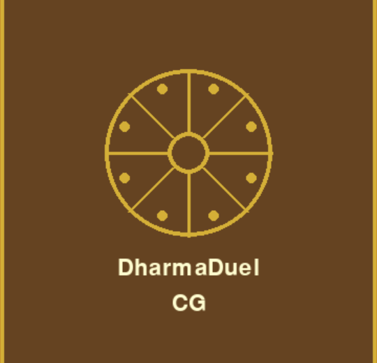
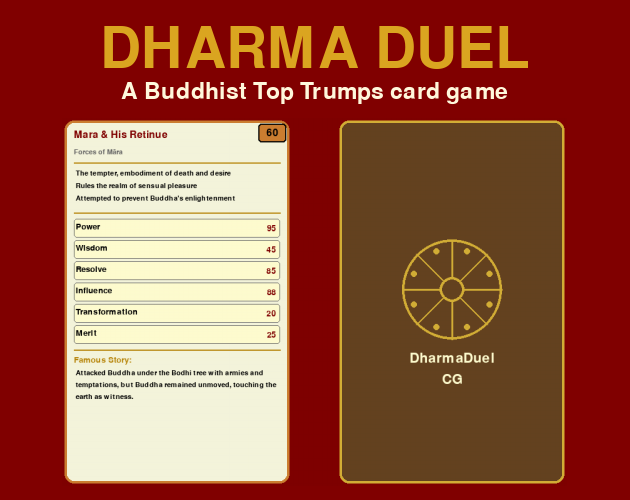
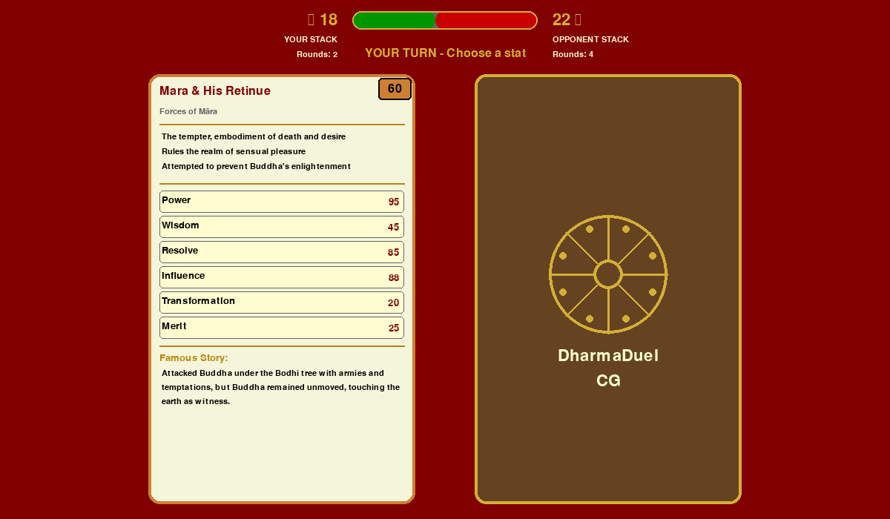
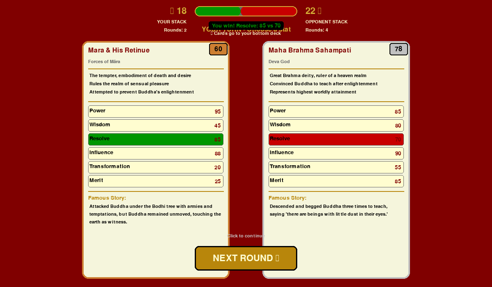
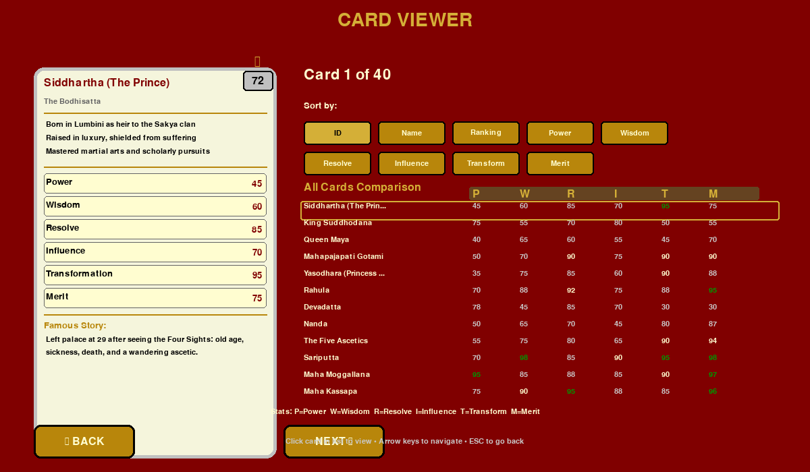
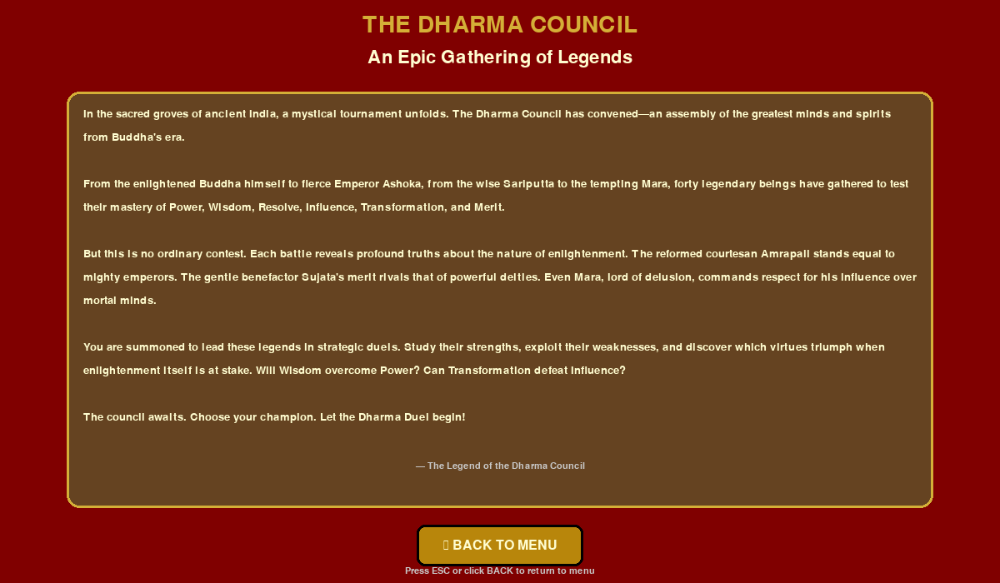
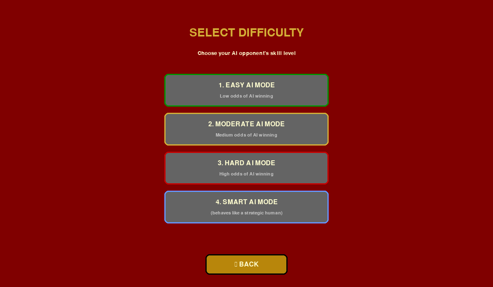
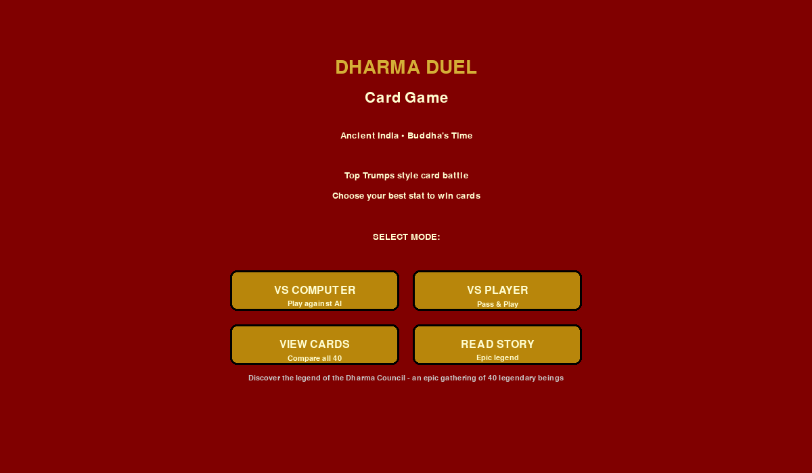

# DharmaDuel CG: Legends of Ancient India

**[Play in browser](https://smoald.itch.io/dharma-duel-cg)** — best played on desktop or tablet in landscape mode. Click Play in browser, then go fullscreen.

A Top Trumps inspired card game featuring 40 legendary Buddhist figures — playable against a smart AI or a friend.

  

## What It Does

- **40 historically researched cards** — Buddhist figures from the Pali Canon, each with a fact file and famous story
- **6 battle stats** — Power, Wisdom, Resolve, Influence, Transformation, Merit (based on the Four Stages of Enlightenment)
- **4 AI difficulty levels** — Easy, Moderate, Hard, and Smart (behaves like a strategic human)
- **Two game modes** — VS Computer and Pass & Play (two people, one device)
- **Card viewer** — browse all 40 cards, sort by any stat, view full rankings 1–40
- **Near-perfect balance** — 49.4% vs 50.6% win rate, verified by a 10,000-game simulation

## Screenshots

The cover and screenshots from the itch.io store page.

<table>
  <tr><td align="center"> Your turn: pick a stat</td><td align="center"> Round result</td></tr>
  <tr><td align="center"> Card viewer</td><td align="center"> The story of the Dharma Council</td></tr>
  <tr><td align="center"> Choosing the AI difficulty</td><td align="center"> Main menu</td></tr>
</table>

## Built With

- **Python** — core programming language
- **Pygame** — handles the game window, card rendering, and user input
- **JSON** — card database (`data/cards.json`), easy to edit without touching code
- **GitHub Actions** — runs automated prompt evaluation on every push

## How to Run It

1. Install Python from [python.org](https://python.org)
2. Install Pygame: `pip install pygame`
3. Run: `python main.py`
4. Choose a mode and play

**Windows users:** double-click `run_game.bat` — it installs Pygame automatically if needed.

**Want a standalone executable?** Download the `.exe` from [Itch.io](https://smoald.itch.io/dharma-duel-cg) — no Python needed.

**Play in the browser** at [smoald.itch.io/dharma-duel-cg](https://smoald.itch.io/dharma-duel-cg) — best on desktop or tablet in landscape mode, fullscreen recommended. Not designed for mobile phones.

## My Journey

**29 May 2026 — Browser Version Live on Itch.io**

Got the game running in the browser using pygbag — a tool that converts Python/Pygame to WebAssembly. The web version lives in a separate `dharma_duel_web/` folder so the original game code stays untouched. The game now has both a Windows download and a Play in browser option on Itch.io.

Key lesson: viewport size tweaking produced inconsistent results across different screen sizes. Fullscreen mode solved it cleanly — the browser scales the game correctly to whatever screen the player has.

---

**28 May 2026 — Added a Prompt Library**

I added a `/prompts` folder documenting every major design decision made during the build — from the initial game concept to the AI difficulty system. Each of the 7 prompts has the original prompt text, a reasoning file explaining *why* the decision was made, and a testable rubric. All 7 pass at 100% using the automated eval runner.

Key lesson: being asked *why* for each decision forced me to articulate things I'd done instinctively. For example, I hadn't consciously framed the legend card decision as "rarity creates excitement" until the process asked me to justify it.

---

**28 May 2026 — Shipped to GitHub and Itch.io**

I took Dharma Duel from a folder on my computer to a live, downloadable game. Created the GitHub repo, fixed a PyInstaller path bug so the Windows executable could find its card data after packaging, and published on Itch.io.

Key lesson: Render hosts web servers, Itch.io hosts downloadable games — match the tool to what you're actually building.

## What's Next

- Sound effects and card reveal animations
- Animated Dharmachakra wheel on card backs
- Expanding the card set (more Jataka figures)
